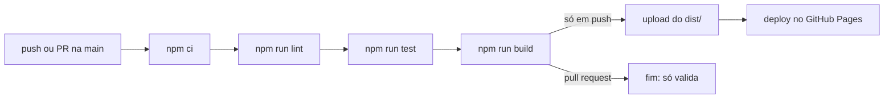

# ☄️ Cometa — metas em órbita

[](https://github.com/yyunkprod0244-gif/cometa-metas/actions/workflows/main.yml)

Aplicação front-end em **React + Vite** com **pipeline de CI/CD no GitHub Actions**: a cada push ou pull request na `main` o código passa por lint, testes e build, e todo push na `main` publica o site automaticamente no **GitHub Pages**.

## 📦 Dados da entrega

| | |
| --- | --- |
| 🌐 **Site publicado** | https://yyunkprod0244-gif.github.io/cometa-metas/ |
| 📁 **Repositório** | https://github.com/yyunkprod0244-gif/cometa-metas |
| ✅ **Histórico de execuções (evidência)** | https://github.com/yyunkprod0244-gif/cometa-metas/actions |
| ⚙️ **Workflow** | [`.github/workflows/main.yml`](.github/workflows/main.yml) |
| 🚀 **Deploy** | GitHub Pages, publicado automaticamente após cada push na `main` |
| 🧪 **Qualidade** | ESLint + 31 testes (Vitest + Testing Library) + build do Vite |

---

## 🚀 Pipeline de CI/CD



### Quando roda

| Evento | CI (lint, testes, build) | CD (deploy) |
| --- | :---: | :---: |
| `push` na `main` | ✅ | ✅ |
| `pull_request` para a `main` | ✅ | — |
| Manual (botão **Run workflow** na aba Actions) | ✅ | ✅ |

### Job `ci` — lint, testes e build

| Etapa | Comando | O que garante |
| --- | --- | --- |
| Baixar o código | `actions/checkout` | Código do commit que disparou o workflow |
| Configurar Node.js | `actions/setup-node` | Node da versão do `.nvmrc` (22) com cache do npm |
| Instalar dependências | `npm ci` | Instalação limpa e idêntica ao `package-lock.json` |
| Lint | `npm run lint` | Código sem erros de padrão (ESLint) |
| Testes | `npm run test` | Regras de negócio e interface funcionando (Vitest) |
| Build | `npm run build` | Projeto compila para produção (`dist/`) |
| Enviar build | `actions/upload-pages-artifact` | Guarda o `dist/` para o deploy (só fora de PR) |

Se qualquer etapa falhar, o workflow para ali e **o deploy não acontece** — nada quebrado chega ao ar.

### Job `deploy` — publicação no GitHub Pages

Depende do job `ci` (`needs: ci`) e só roda em push na `main`. Usa `actions/configure-pages` e `actions/deploy-pages`; o link do site aparece no resumo da execução (ambiente `github-pages`).

### Cuidados no workflow

- **Permissões mínimas:** o workflow só lê o repositório (`contents: read`); apenas o job de deploy recebe `pages: write` e `id-token: write`.
- **Concorrência:** em PR, um push novo cancela a execução anterior; na `main`, o deploy em andamento termina antes do próximo.
- **Versão publicada visível:** a variável `VITE_COMMIT_SHA` recebe `${{ github.sha }}` e o hash aparece no rodapé do site. Ele bate com o último commit da `main`, o que confirma que o deploy automático está em dia.

## 🔐 Secrets

O deploy usa o **`GITHUB_TOKEN`**, secret que o GitHub cria automaticamente em cada execução — não é preciso cadastrá-lo. O workflow só declara as permissões necessárias e o referencia assim:

```yaml
- name: Publicar site
  uses: actions/deploy-pages@v4
  with:
    token: ${{ secrets.GITHUB_TOKEN }}
```

- Nenhum token, senha ou chave fica escrito no código — tudo vem de `secrets.*`
- Arquivos `.env` estão no `.gitignore`
- Variáveis `VITE_*` vão para o JavaScript público do site, por isso **nunca** guardam dados sensíveis

---

## ✨ Sobre o app

- Criar metas com título, categoria (Estudo, Carreira, Saúde, Pessoal) e número de etapas
- Avançar e voltar etapas, com anel de progresso animado
- Filtros: todas, em andamento e concluídas
- Painel com total de metas, concluídas e progresso médio
- Dados salvos no `localStorage` do navegador
- Tema escuro/claro com botão (a escolha fica salva)
- Visual 3D: cena com planeta e cometa em CSS 3D e cartões que inclinam com o mouse

| Área | Ferramenta |
| --- | --- |
| Interface | React 19 |
| Build / dev server | Vite |
| Lint | ESLint 9 (flat config) + regras de React Hooks |
| Testes | Vitest + Testing Library + jsdom |
| CI/CD | GitHub Actions |
| Hospedagem | GitHub Pages |

## 💻 Rodando localmente

Pré-requisito: **Node.js 20.19+ ou 22.12+** (o CI usa a 22).

```bash
git clone https://github.com/yyunkprod0244-gif/cometa-metas.git
cd cometa-metas
npm ci
npm run dev
```

| Comando | O que faz |
| --- | --- |
| `npm run dev` | Servidor de desenvolvimento (http://localhost:5173) |
| `npm run lint` | Verifica o código com ESLint |
| `npm run test` | Roda todos os testes uma vez (é o que o CI usa) |
| `npm run test:watch` | Testes em modo observação |
| `npm run build` | Gera a versão de produção em `dist/` |
| `npm run preview` | Serve o `dist/` localmente para conferir o build |

> Antes de cada push, `npm run lint && npm run test && npm run build` reproduz exatamente o que o CI vai fazer.

## 🧪 Testes

- **`src/utils/metas.test.js`** — validação, criação, avanço de etapas, cálculo de progresso, filtros e resumo.
- **`src/App.test.jsx`** — fluxo do usuário: adicionar meta, erro de validação, avançar até concluir, voltar etapa, filtrar, remover, salvar no `localStorage` e alternar o tema.

## 📁 Estrutura

```
cometa-metas/
├── .github/workflows/main.yml   # pipeline de CI/CD
├── public/favicon.svg
├── src/
│   ├── components/              # BotaoTema, CartaoMeta, CenaCometa, Filtros, FormularioMeta, Painel
│   ├── hooks/                   # useMetas, useTema
│   ├── utils/                   # regras de negócio, testes e acesso ao localStorage
│   ├── App.jsx / App.test.jsx
│   ├── main.jsx / setupTests.js
│   └── styles.css
├── .nvmrc                       # versão do Node usada no CI
├── eslint.config.js
├── vite.config.js               # inclui a configuração do Vitest
└── package.json
```

---

<details>
<summary><strong>Reproduzir o deploy em outro repositório</strong></summary>

1. Faça um fork ou envie o código para um repositório **público** com a branch `main` (inclua o `package-lock.json`).
2. Em **Settings → Pages → Build and deployment → Source**, escolha **GitHub Actions**.
3. Faça um push na `main` (ou use **Run workflow** na aba Actions). O link aparece no job de deploy.

| Erro no log | Como resolver |
| --- | --- |
| `npm ci` pede um `package-lock.json` | Rode `npm install` localmente e faça commit do `package-lock.json` |
| `Get Pages site failed` / `Not Found` | Ative o Pages com a fonte **GitHub Actions** e rode o workflow de novo |
| `Resource not accessible by integration` | Confira `permissions` do job `deploy` (`pages: write`, `id-token: write`) |
| Site abre em branco | Mantenha `base: './'` no `vite.config.js` |
</details>

<details>
<summary><strong>Alternativa: deploy na Vercel com <code>VERCEL_TOKEN</code></strong></summary>

Cadastre `VERCEL_TOKEN`, `VERCEL_ORG_ID` e `VERCEL_PROJECT_ID` em **Settings → Secrets and variables → Actions** e troque o job `deploy` por:

```yaml
  deploy:
    needs: ci
    if: github.event_name != 'pull_request' && github.ref == 'refs/heads/main'
    runs-on: ubuntu-latest
    env:
      VERCEL_ORG_ID: ${{ secrets.VERCEL_ORG_ID }}
      VERCEL_PROJECT_ID: ${{ secrets.VERCEL_PROJECT_ID }}
    steps:
      - uses: actions/checkout@v4
      - run: npm install --global vercel@latest
      - run: vercel pull --yes --environment=production --token=${{ secrets.VERCEL_TOKEN }}
      - run: vercel build --prod --token=${{ secrets.VERCEL_TOKEN }}
      - run: vercel deploy --prebuilt --prod --token=${{ secrets.VERCEL_TOKEN }}
```
</details>

---

© 2026 Douglas Henrique
