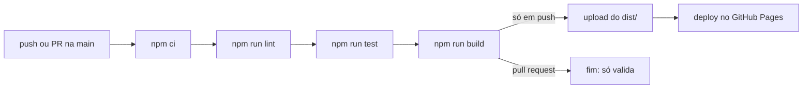

# ☄️ Cometa — metas em órbita

[](https://github.com/yyunkprod0244/cometa-metas/actions/workflows/main.yml)

**🔗 Site publicado:** https://SEU-USUARIO.github.io/cometa-metas/

Aplicação front-end em **React + Vite** para organizar metas em etapas, com uma **pipeline completa de CI/CD no GitHub Actions**: a cada push ou pull request na `main` o código passa por lint, testes e build, e todo push na `main` publica o site automaticamente no **GitHub Pages**.

> Exercício de CI/CD com GitHub Actions — workflows em `.github/workflows/`, automação de lint/testes/build, deploy automatizado e uso de secrets.

---

## ✨ Funcionalidades do app

- Criar metas com título, categoria (Estudo, Carreira, Saúde, Pessoal) e número de etapas
- Avançar e voltar etapas, com anel de progresso animado
- Filtros: todas, em andamento e concluídas
- Painel com total de metas, concluídas e progresso médio
- Dados salvos no `localStorage` do navegador
- Tema escuro/claro com botão (a escolha fica salva)
- Visual 3D: cena com planeta e cometa em CSS 3D e cartões que inclinam com o mouse
- Rodapé mostra o **hash do commit publicado**, então dá para conferir que o deploy está atualizado

## 🛠️ Tecnologias

| Área | Ferramenta |
| --- | --- |
| Interface | React 19 |
| Build / dev server | Vite 7 |
| Lint | ESLint 9 (flat config) + regras de React Hooks |
| Testes | Vitest + Testing Library + jsdom |
| CI/CD | GitHub Actions |
| Hospedagem | GitHub Pages |

---

## 🚀 Pipeline de CI/CD

Arquivo: [`.github/workflows/main.yml`](.github/workflows/main.yml)



### Quando roda

| Evento | CI (lint, testes, build) | CD (deploy) |
| --- | :---: | :---: |
| `push` na `main` | ✅ | ✅ |
| `pull_request` para a `main` | ✅ | — |
| Manual (botão **Run workflow** na aba Actions) | ✅ | ✅ |

### Jobs

**1. `ci` — CI · lint, testes e build**

| Etapa | Comando | O que garante |
| --- | --- | --- |
| Baixar o código | `actions/checkout@v4` | Código do commit que disparou o workflow |
| Configurar Node.js | `actions/setup-node@v4` | Node da versão do `.nvmrc` (22) com cache do npm |
| Instalar dependências | `npm ci` | Instalação limpa e idêntica ao `package-lock.json` |
| Lint | `npm run lint` | Código sem erros de padrão (ESLint) |
| Testes | `npm run test` | Regras de negócio e interface funcionando (Vitest) |
| Build | `npm run build` | Projeto compila para produção (`dist/`) |
| Enviar build | `actions/upload-pages-artifact@v3` | Guarda o `dist/` para o deploy (só fora de PR) |

Se qualquer etapa falhar, o workflow para ali e **o deploy não acontece** — nada quebrado chega ao ar.

**2. `deploy` — CD · deploy no GitHub Pages**

Depende do job `ci` (`needs: ci`) e só roda em push na `main`. Usa `actions/configure-pages@v5` e `actions/deploy-pages@v4`, e o link do site aparece no resumo da execução (ambiente `github-pages`).

### Outros cuidados no workflow

- **Permissões mínimas:** o workflow inteiro só lê o repositório (`contents: read`); apenas o job de deploy ganha `pages: write` e `id-token: write`.
- **Concorrência:** em PR, um push novo cancela a execução anterior; na `main`, o deploy em andamento termina antes do próximo.
- **Hash do commit no build:** a variável `VITE_COMMIT_SHA` recebe `${{ github.sha }}` e aparece no rodapé do site.

---

## 🔐 Secrets

Este projeto usa o **`GITHUB_TOKEN`**, um secret que o próprio GitHub cria automaticamente em cada execução do workflow. **Não é preciso cadastrar nada manualmente**: o workflow só declara as permissões de que precisa e referencia o token assim:

```yaml
- name: Publicar site
  uses: actions/deploy-pages@v4
  with:
    token: ${{ secrets.GITHUB_TOKEN }}
```

Boas práticas seguidas:

- Nenhum token, senha ou chave fica escrito no código — tudo vem de `secrets.*`
- Arquivos `.env` estão no `.gitignore`
- Variáveis `VITE_*` vão para o JavaScript público do site, então **nunca** guardam nada sensível

<details>
<summary><strong>Alternativa: deploy na Vercel com <code>VERCEL_TOKEN</code></strong></summary>

1. Crie um token em **vercel.com → Account Settings → Tokens**.
2. Rode `npx vercel link` na pasta do projeto e copie `orgId` e `projectId` de `.vercel/project.json`.
3. No GitHub, vá em **Settings → Secrets and variables → Actions → New repository secret** e cadastre `VERCEL_TOKEN`, `VERCEL_ORG_ID` e `VERCEL_PROJECT_ID`.
4. Troque o job `deploy` do `main.yml` por:

```yaml
  deploy:
    needs: ci
    if: github.event_name != 'pull_request' && github.ref == 'refs/heads/main'
    runs-on: ubuntu-latest
    env:
      VERCEL_ORG_ID: ${{ secrets.VERCEL_ORG_ID }}
      VERCEL_PROJECT_ID: ${{ secrets.VERCEL_PROJECT_ID }}
    steps:
      - uses: actions/checkout@v4
      - run: npm install --global vercel@latest
      - run: vercel pull --yes --environment=production --token=${{ secrets.VERCEL_TOKEN }}
      - run: vercel build --prod --token=${{ secrets.VERCEL_TOKEN }}
      - run: vercel deploy --prebuilt --prod --token=${{ secrets.VERCEL_TOKEN }}
```

E remova a etapa "Enviar build para o GitHub Pages" do job `ci`.
</details>

---

## 💻 Rodando localmente

Pré-requisito: **Node.js 20.19+ ou 22.12+** (o CI usa a 22).

```bash
git clone https://github.com/SEU-USUARIO/cometa-metas.git
cd cometa-metas
npm install
npm run dev
```

Abra o endereço mostrado no terminal (normalmente http://localhost:5173).

### Scripts

| Comando | O que faz |
| --- | --- |
| `npm run dev` | Servidor de desenvolvimento |
| `npm run lint` | Verifica o código com ESLint |
| `npm run test` | Roda todos os testes uma vez (é o que o CI usa) |
| `npm run test:watch` | Testes em modo observação |
| `npm run build` | Gera a versão de produção em `dist/` |
| `npm run preview` | Serve o `dist/` localmente para conferir o build |

> Dica: rode `npm run lint && npm run test && npm run build` antes do push — é exatamente o que o CI vai fazer.

---

## 🌐 Configurando o deploy do zero (primeira vez)

1. Crie o repositório **público** `cometa-metas` no GitHub.
2. Na pasta do projeto, rode `npm install` — isso gera o **`package-lock.json`**, que precisa ir para o repositório (o `npm ci` do CI depende dele).
3. Envie o código:
   ```bash
   git init
   git add .
   git commit -m "feat: projeto Cometa com pipeline de CI/CD"
   git branch -M main
   git remote add origin https://github.com/SEU-USUARIO/cometa-metas.git
   git push -u origin main
   ```
4. No GitHub, abra **Settings → Pages** e em **Build and deployment → Source** escolha **GitHub Actions**.
5. Vá na aba **Actions**, abra o workflow **CI/CD** e clique em **Re-run all jobs** (o primeiro push pode falhar no deploy se o Pages ainda não estava ativado).
6. Quando o job `deploy` ficar verde, o link do site aparece no resumo da execução. Atualize o link no topo deste README e o badge, trocando `SEU-USUARIO` pelo seu usuário.

## ✅ Evidência de funcionamento

O histórico completo das execuções fica na aba **[Actions](https://github.com/SEU-USUARIO/cometa-metas/actions)** do repositório. Em cada execução dá para ver:

- o job **CI · lint, testes e build** com cada etapa e seus logs;
- o job **CD · deploy no GitHub Pages** com o link publicado;
- em pull requests, só o CI rodando (sem deploy).

O hash mostrado no rodapé do site é o mesmo do último commit da `main`, o que confirma que o deploy automático está funcionando.

## 🧯 Solução de problemas

| Erro no log | Causa provável | Como resolver |
| --- | --- | --- |
| `npm ci` pede um `package-lock.json` | O lockfile não foi enviado | Rode `npm install` localmente e faça commit do `package-lock.json` |
| `Get Pages site failed` / `Not Found` no deploy | GitHub Pages não está ativado com a fonte "GitHub Actions" | Settings → Pages → Source: **GitHub Actions** e rode o workflow de novo |
| `Resource not accessible by integration` | Permissões do token | Confira o bloco `permissions` do job `deploy` (`pages: write`, `id-token: write`) |
| Site abre em branco | Caminhos dos arquivos | O `vite.config.js` usa `base: './'`; não remova essa linha |
| Falha no lint ou nos testes | Erro no código | Leia a etapa vermelha no log, corrija localmente e faça novo push |

---

## 📁 Estrutura

```
cometa-metas/
├── .github/
│   └── workflows/
│       └── main.yml          # pipeline de CI/CD
├── public/
│   └── favicon.svg
├── src/
│   ├── components/           # BotaoTema, CartaoMeta, CenaCometa, Filtros, FormularioMeta, Painel
│   ├── hooks/                # useMetas, useTema
│   ├── utils/
│   │   ├── metas.js          # regras de negócio (funções puras)
│   │   ├── metas.test.js     # testes das regras
│   │   └── armazenamento.js  # acesso seguro ao localStorage
│   ├── App.jsx
│   ├── App.test.jsx          # testes de interface (Testing Library)
│   ├── main.jsx
│   ├── setupTests.js
│   └── styles.css
├── .gitignore
├── .nvmrc                    # versão do Node usada no CI
├── eslint.config.js
├── index.html
├── package.json
├── vite.config.js            # inclui a configuração do Vitest
└── README.md
```

## 🧪 Testes

- **`src/utils/metas.test.js`** — validação, criação, avanço de etapas, cálculo de progresso, filtros e resumo.
- **`src/App.test.jsx`** — fluxo do usuário: adicionar meta, erro de validação, avançar até concluir, voltar etapa, filtrar, remover, salvar no `localStorage` e alternar o tema.

---

© 2026 Douglas Henrique
